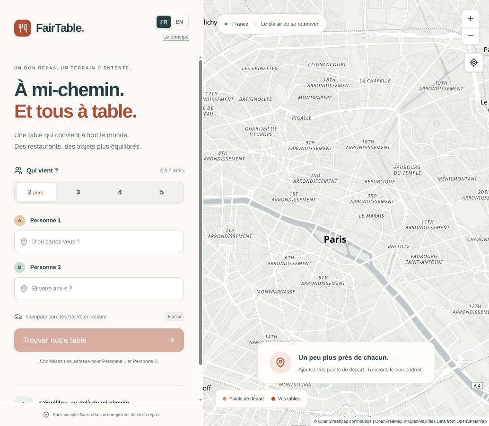

# FairTable

**Good company. Common ground.** Find a restaurant that shares the journey fairly between 2–5 friends in France. FairTable compares the difference between friends’ journeys and the longest trip, rather than simply finding a restaurant near an average location.

French and English · 2–5 participants · No account or API key required



A pnpm monorepo with a React/Vite interface, a Fastify API and a shared package of pure fairness calculations. The API integrates public French geocoding/routing and OpenStreetMap restaurant data.

[Quick start](#run-locally) · [Docker](#production-containers) · [Configuration](#configuration-reference) · [Architecture](ARCHITECTURE.md)

## Run locally

Requires **Node.js 24 LTS** and **pnpm 11.19.0** (the package manager version is pinned).

```sh
git clone https://github.com/Lionelsan95/fair_table.git
cd fair_table
corepack enable
corepack prepare pnpm@11.19.0 --activate
pnpm install --frozen-lockfile
cp .env.example .env
pnpm dev
```

Open http://localhost:5173. Vite reports another port if 5173 is occupied. If you use nvm, run `nvm use` first. The API listens on port 3001; `GET /api/health` checks it. Vite proxies `/api` to the backend. No secret, API key, credit card, database, or external account is needed.

To work without consuming public search/routing APIs, set `USE_MOCK_PROVIDERS=true` in `.env` and restart. Type “Paris” in each address field and choose the République, Bastille and Saint-Michel examples. A visible demo banner identifies all example places/journeys as synthetic. Map tiles still use OpenFreeMap. Live providers are the default.

```sh
pnpm lint          # ESLint and Prettier checks
pnpm format        # Format source and documentation
pnpm typecheck     # Strict TypeScript in all three packages
pnpm test          # Domain, provider, Fastify inject and React tests
pnpm exec playwright install chromium
pnpm test:e2e      # Desktop, 390px mobile and 820px tablet; deterministic APIs/map
pnpm build        # Production API bundle and static frontend
```

On a minimal Linux host Playwright may also need `pnpm exec playwright install-deps chromium`. E2E does not require live external providers or a running backend. It starts Vite if needed. Reports and responsive captures are written to `playwright-report/` and `test-results/`.

GitHub Actions runs these checks on pushes and pull requests, using mock providers and a deterministic map style. Failed browser runs retain diagnostics for seven days. CI checks the application; it does not publish it.

## Production containers

```sh
docker compose up --build
# Or explicitly use synthetic providers:
USE_MOCK_PROVIDERS=true docker compose up --build
```

Visit http://localhost:8080. If that port is occupied, use `WEB_PORT=8088 docker compose up --build` and visit http://localhost:8088. The published port binds only to localhost. The unprivileged Nginx frontend proxies the private API container. Both images have build stages; neither requires a database. For an internet deployment, supply TLS through your ingress, configure origins, and size or replace the public provider queues for your expected traffic. The built frontend reads `VITE_*` settings at build time. `PORT` changes in development also require changing the Vite proxy target. Docker fixes its internal port to 3001.

### Hosting status

The repository includes working local development and Docker deployment. Pushing this source to GitHub does **not** make the application available as a hosted website, and GitHub Pages alone cannot run the API.

Sites and Netlify deployment adapters are not implemented yet. Either target can reuse the UI and domain logic, but the backend needs a compatible server entry point, request deadlines and a review of provider throttling across instances. The current Docker setup remains the supported deployment path.

## What is implemented

- French/English UI with a language switch that preserves addresses, custom names, search results and selection.
- 2–5 stable participant identities, editable names, debounced/cancellable keyboard autocomplete, selected-address validation and reset.
- A minimax search center, adaptive 2/5/10/15 km discovery and a configurable eight-candidate geometric shortlist.
- Up to five ranked restaurants, participant journeys, maximum difference, indicative balance score, optional OSM metadata and safe external links.
- A MapLibre instance retained across renders, matching A–E / 1–5 markers, bidirectional selection, fit-to-group and a mobile map plus results sheet with expanding details.
- Useful loading, empty, provider-error, retry, approximate-routing and map-error states. Keyboard and reduced-motion support; the list is the map’s accessible equivalent.
- Request validation, bounded provider queues, deadlines, restrained retries and no-store responses.

## Languages and configuration

French and English are built in. Use **FR / EN** in the header at any point; selected addresses, custom names, search results and map selection survive the switch. UI copy, accessibility labels, errors, number formatting and common OSM metadata are translated. Real names, addresses and raw opening-hours expressions are preserved.

Language selection follows `?lang=fr` / `?lang=en`, then the browser’s first supported language, then `VITE_DEFAULT_LOCALE` (default `fr`). Switching updates only the URL language preference; there are no cookies or saved addresses. The fallback is a build-time setting in `.env` and Docker Compose. For example, open `http://localhost:5173/?lang=fr` to preview French regardless of your browser preference.

Catalogs and locale configuration live in `apps/web/src/i18n/`. Adding a language means adding a complete typed catalog and registering its code, label and Intl locale. UI components use `useI18n()`; meeting state lives in `useMeeting()`. No translation framework, runtime catalog fetching or new backend service is required. See the architecture notes for extension boundaries.

## Configuration reference

Copy `.env.example` to `.env` at the repository root. Never commit actual environment files.

| Variable              | Default                 | Purpose                                                             |
| --------------------- | ----------------------- | ------------------------------------------------------------------- |
| `USE_MOCK_PROVIDERS`  | `false`                 | Synthetic addresses, restaurants and journeys for local development |
| `PORT`                | `3001`                  | Development API port; update the Vite proxy if changed              |
| `WEB_ORIGIN`          | `http://localhost:5173` | Allowed browser origin                                              |
| `WEB_PORT`            | `8080`                  | Published Docker port on localhost                                  |
| `SHORTLIST_SIZE`      | `8`                     | Number of restaurants receiving route comparisons; 5–12             |
| `FINAL_RADIUS_METERS` | `15000`                 | Final discovery radius; 10000–30000 metres                          |
| `VITE_DEFAULT_LOCALE` | `fr`                    | Language fallback after URL and browser preferences                 |
| `VITE_API_BASE_URL`   | empty                   | Same-origin API by default; optional external API origin            |
| `VITE_MAP_STYLE_URL`  | OpenFreeMap Positron    | MapLibre style URL                                                  |

Provider URLs and defaults are listed in `.env.example`. `GEOPLATFORM_GEOCODING_BASE_URL` is reserved for future forward geocoding; autocomplete already returns coordinates. `VITE_*` values are applied at build time and require rebuilding. Docker Compose forwards only the settings explicitly listed in `docker-compose.yml`; its API port and same-origin proxy are fixed.

## Fairness, explained

Discovery starts at the center of the smallest enclosing circle in a local planar approximation. That point only defines where to look for restaurants. Every candidate is compared using distances from **all** participants; only the strongest eight candidates receive road-route requests.

Final ordering gives **70% weight to fairness** (journey spread and population standard deviation) and **30% to the longest journey**. Components use a common normalization scale: the longest journey across the candidate set. This prevents a trivial imbalance from outweighing a large convenience improvement. Equal journeys that are unnecessarily long lose to equally balanced shorter journeys. The mean journey is returned for transparency but does not drive the ranking.

The displayed 0–100 balance indicator is `100 × (1 − spread / longest journey)`, rounded, with 100 for all-zero trips. It describes balance, not restaurant quality or absolute mathematical truth. “Maximum difference” is shown prominently. Ordering also considers convenience, so score alone does not determine rank. Comparisons depend on the candidates found; a geometric shortlist can miss a restaurant favoured by unusual road networks.

If any shortlisted road journey fails, the **entire comparison switches to straight-line kilometres**. No travel durations are invented or mixed with distances. The UI makes that fallback explicit. Driving times are estimates without live traffic. Pedestrian routing is supported by the API but is not exposed in the MVP interface.

## Open-data providers and attribution

- [Géoplateforme autocomplete](https://cartes.gouv.fr/aide/fr/guides-utilisateur/utiliser-les-services-de-la-geoplateforme/autocompletion/) supplies French addresses and coordinates. Public Nominatim is not used.
- [Géoplateforme routes](https://cartes.gouv.fr/aide/fr/guides-utilisateur/utiliser-les-services-de-la-geoplateforme/calcul-itineraire/) supplies fastest driving/pedestrian metrics. The adapter conservatively starts at most one request per 300 ms, serially, per process, including retries.
- [Overpass](https://wiki.openstreetmap.org/wiki/Overpass_API) discovers only OSM `amenity=restaurant` nodes, ways and relations. Availability is best-effort; the adapter can be replaced or self-hosted.
- [OpenFreeMap](https://openfreemap.org/) provides the quiet Positron map. Public hosting is currently free. The style URL is centralized in `VITE_MAP_STYLE_URL`, so style/source can be replaced without vendor coupling.
- **Keep OpenStreetMap attribution visible**, including its [copyright/license link](https://www.openstreetmap.org/copyright). MapLibre preserves source attribution, and FairTable adds an explicit OSM credit. Restaurant details identify their OSM source. Preserve other source credits when changing styles.

Restaurant information comes from OpenStreetMap and may be incomplete or out of date. There are no invented ratings, prices, reviews, photographs or missing metadata. OSM does not provide a general consumer-review system. Missing names are labelled “Unnamed restaurant”; cuisine has an explicit fallback. Named records are preferred in normalization and nearby node/way duplicates are merged conservatively by name and distance.

## Privacy and limitations

No persistence, accounts, cookies, analytics or tracking scripts. Participant details live only in browser/server memory during use. Autocomplete text is sent to IGN; meeting-center areas to Overpass; participant/restaurant endpoints to IGN routing. Map requests are sent directly from the browser to the configured tile host and expose its IP/view area. Those services have their own operational logs and policies.

Fastify’s automatic request logging is disabled (including URLs with address queries). Application logs contain only request ID, participant count, latency, result count and status. Nginx access logging is off. API responses use `Cache-Control: no-store`. Infrastructure operators must preserve this policy in reverse proxies and observability tooling. In-memory request throttling retains IP counters briefly for abuse prevention; no location data is stored there.

This France-first geocoding/routing strategy intentionally uses Géoplateforme. The meeting-center projection is intended for regional groups, not antipodal/worldwide locations. Unreachable or overseas routes may fall back to geodesic comparisons. Search explores a bounded area (15 km final default), not every possible restaurant in France. Public-service latency and completeness constrain results. Opening-hours strings are displayed as supplied, not evaluated as “open now”.

Queues and limits are per process, designed for a small single-instance MVP. Two meeting searches run concurrently; additional requests receive a retryable error. Routes have a 30-second comparison deadline, and the total search has a 110-second deadline. Scaling replicas behind a shared public IP requires a shared limiter or replacement/self-hosted provider. There is deliberately no authentication, booking, database or other out-of-scope infrastructure.

## Repository

- `apps/web/`: React, Vite, Tailwind v4, shadcn-style Base UI button, TanStack Query, Lucide, MapLibre; UI and component tests.
- `apps/api/`: Fastify v5, provider adapters, bounded network calls, orchestration and API tests.
- `packages/domain/`: shared validated contracts, pure geometry, statistics, fairness and ranking.
- `e2e/`: Playwright browser flows and responsive captures.
- [ARCHITECTURE.md](ARCHITECTURE.md): decisions, data flow, boundaries and replacement points.

## Development workflow

Keep changes focused: domain rules belong in `packages/domain`, external HTTP integrations in `apps/api/src/providers`, and presentation/translations in `apps/web/src`. Run the checks above before opening a pull request. Use mock providers for repeatable development and tests.

Dependency versions and the lockfile are pinned. Update them deliberately together, then run lint, type checks, tests and builds. Do not commit dependency folders, generated builds, environment files or browser reports. This repository does not configure automatic deployment or require GitHub secrets.

## Screenshots

Playwright saves ready/results captures for desktop, mobile and tablet under `test-results/`. The map in these deterministic test captures uses a local blank style, so tests never depend on tile availability. Run the app with public tiles to see the full map.

The compiler is pinned to TypeScript 6.0.3 to match the checked-in lint toolchain.
